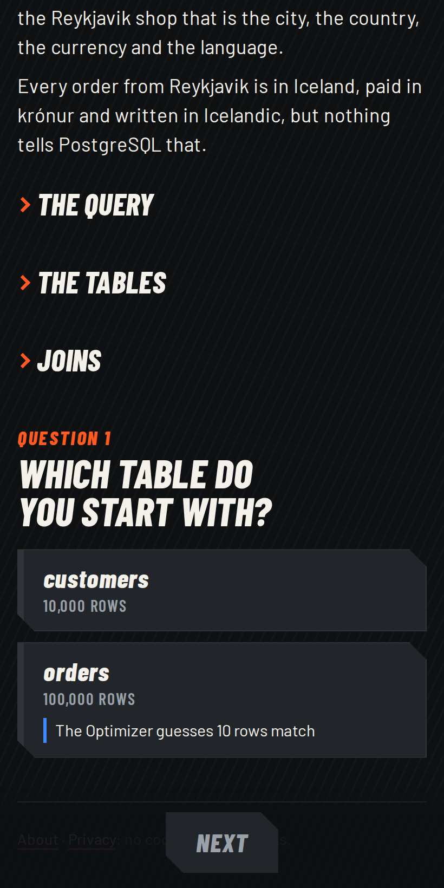
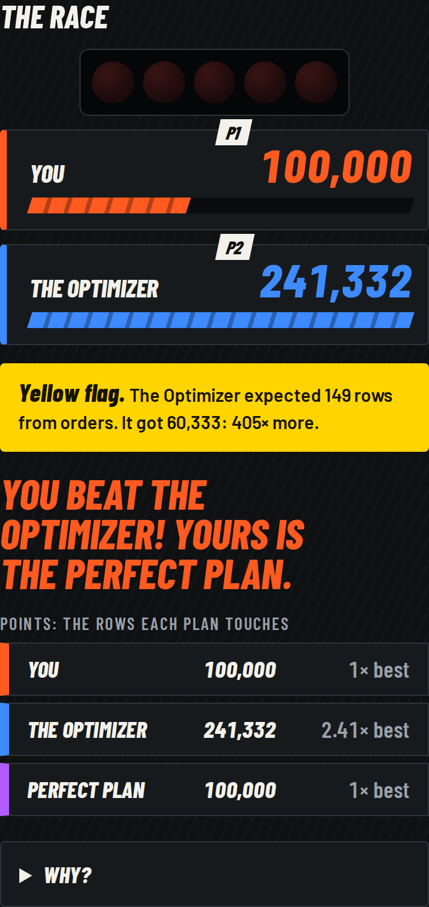

# Beat the Optimizer

[](https://github.com/Diafyx/beat-the-optimizer/actions/workflows/ci.yml?query=branch%3Amain)
[](https://scorecard.dev/viewer/?uri=github.com/Diafyx/beat-the-optimizer)
[](LICENSE)

A daily puzzle for people who write SQL. Each level gives you a query and a few
tables. You choose the join order, how each table is read and how each join is
done. Then your plan runs against the plan PostgreSQL chose for the same query.

> **Status:** early development. The first public version is `v0.1.0`, with 10
> levels, a daily rotation and a share card.



## Play

- **One puzzle a day**, the same for everyone. Read the query, the tables and
  the statistics PostgreSQL planned with, then build your plan by answering a
  few questions.
- **Four runs** per puzzle. Each run shows what every operator costs, then how
  your plan compares with PostgreSQL's and with the best plan there is, and
  why PostgreSQL chose its plan.
- **A streak** for playing on consecutive days, and a **share card** that
  shows how you did without giving the plan away.
- **Practice** any level with `?level=<id>`; it does not count towards your
  streak.
- It works on phones, needs no account and sets no cookies. The game's
  `/privacy` page says exactly what it stores and sends, and `/about` explains
  the scoring and its limits.



## How it works

- **Your plan**: pick the join order, an access path for each table (sequential
  scan or an index) and a join method for each join (hash, nested loop, index
  nested loop or merge).
- **The score**: every operator costs the rows it touches, plus the rows each
  join produces. The cost model is small enough to explain on one page:
  [docs/cost-model.md](docs/cost-model.md), with the reasons in
  [ADR 0002](docs/adr/0002-cost-model-rows-touched.md).
- **The opponent**: every level stores the plan PostgreSQL 18 actually chose,
  recorded against synthetic data. Your plan and Postgres's are scored with the
  same model.
- **The limits**: the game counts rows on the real data, while PostgreSQL
  prices pages and CPU work from its estimates. Beating it means your plan
  touches fewer rows, not that it would run faster on a real server. The
  in-game about page ([`about.html`](about.html)) lists what the model leaves
  out.
- **Measurement**: anonymous counts of visits and next-day returns, with no
  cookies or identifiers, and nothing with Global Privacy Control on. See
  [ADR 0004](docs/adr/0004-measure-return-with-goatcounter.md).

## Run it locally

You need Node.js 22.18 or later, 24 or 26 (see `.nvmrc`). No database is needed.

```bash
npm ci
npm run dev     # start the dev server; ?level=<id> opens a level for practice
npm run check   # run the same checks as CI
```

The level authoring step runs PostgreSQL, so it runs only in GitHub Actions.
[CONTRIBUTING.md](CONTRIBUTING.md) explains every script and rule.

## Supported versions

| Component  | Supported                                                           |
| ---------- | ------------------------------------------------------------------- |
| Node.js    | 22 (22.18 or later), 24 and 26, for development; the site is static |
| Browsers   | Latest Chromium, Firefox and WebKit (Safari), desktop and mobile    |
| PostgreSQL | 18, as the reference optimizer for level authoring                  |

## Licence

This repository has three licences:

- **Code** (everything outside `levels/` and `public/fonts/`) is under the
  [MIT licence](LICENSE).
- **Fonts** in `public/fonts/` (Barlow and Barlow Condensed) are under
  the SIL Open Font License 1.1. See [`public/fonts/OFL.txt`](public/fonts/OFL.txt).
- **Level content** in `levels/` (level files, level specs, stories
  and explanations) is **all rights reserved**. See
  [`levels/LICENSE`](levels/LICENSE). The screenshots in `docs/images/` show
  level content, so they are all rights reserved too.

## Contributing

Bug reports and ideas are welcome. Read [CONTRIBUTING.md](CONTRIBUTING.md)
first. Outside contributions to `levels/` are not accepted, because that
content is all rights reserved.

Everyone taking part follows the [Code of Conduct](CODE_OF_CONDUCT.md). To
report a security problem, see [SECURITY.md](SECURITY.md).
